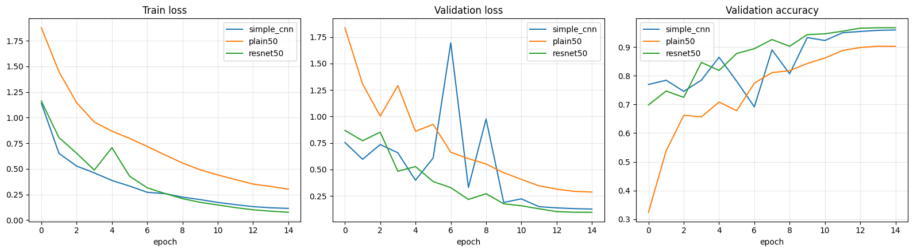
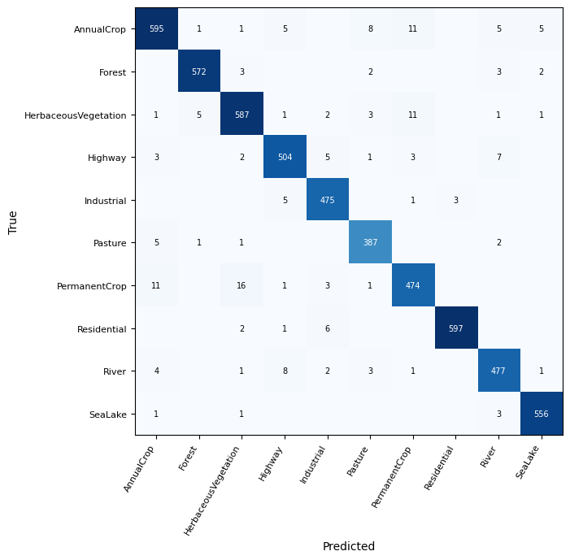
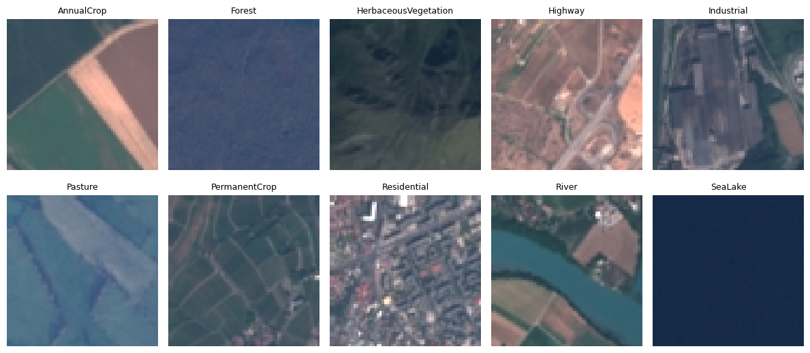

# ResNet vs. Plain Deep CNN on EuroSAT

A small PyTorch project that builds **ResNet-50 from scratch** and tests what its skip connections actually do. It trains three models on satellite images with the same recipe and compares them:

| Model | Description |
|---|---|
| `simple_cnn` | A shallow 4-layer CNN (the "normal CNN" baseline) |
| `plain50` | The exact ResNet-50 layout with the skip connections **removed** |
| `resnet50` | ResNet-50 with bottleneck blocks and skip connections |

The main comparison is `plain50` vs. `resnet50`: same depth, same layers, and the only difference is the `+ x`.

## Results

Trained for 15 epochs on an RTX 3060 Laptop GPU (6 GB), batch size 128, one run per model.

| Model | Parameters | Best val. accuracy | Train time |
|---|---|---|---|
| `simple_cnn` | 0.39M | 95.96% | 206 s |
| `plain50` | 20.74M | 90.30% | 302 s |
| **`resnet50`** | 23.52M | **96.74%** | 364 s |



### What the results show

- **Skip connections matter a lot at depth.** `resnet50` beats `plain50` by about 6.4 points, with identical depth. `plain50` also ends with a much *higher training loss* (0.30 vs. 0.08), so it isn't overfitting. It's struggling to optimize. This is the "degradation problem" described in the ResNet paper.
- **A deeper plain network can be worse than a shallow one.** `plain50` (50 layers) scores below `simple_cnn` (4 layers). Adding depth without skip connections hurt.
- **ResNet's edge over the small CNN is modest here.** `resnet50` beats `simple_cnn` by only ~0.8 points, with 60x more parameters. EuroSAT is relatively easy, so a small CNN does well. A harder dataset would likely widen the gap.
- **Training stability:** `simple_cnn`'s validation loss spikes around epochs 6 to 8, near the peak of the learning-rate schedule, while `resnet50` is smoother overall.

### Caveats

- Each model was trained **once** with a single seed. Differences of under ~1 point (such as `resnet50` vs. `simple_cnn`) could change with a different seed.
- The reported accuracy is on the validation split, which is also what the "best epoch" is picked from. There's no separate test set.
- `resnet50` has ~12% more parameters than `plain50` because it includes four 1x1 conv "reshape" layers on the skip path (explained below). This is standard for ResNet-50 but means the parameter counts are not exactly equal.
- Training times are not a clean speed benchmark. The notebook uses `NUM_WORKERS = 0`, so image augmentation runs on the main process, which most likely slows the small CNN down more than the big ones.

## Confusion matrix



The matrix is for the best model (`resnet50`) on the validation set.

## Dataset

[EuroSAT](https://github.com/phelber/EuroSAT): 27,000 Sentinel-2 satellite images, 64x64 RGB, 10 land-use classes (AnnualCrop, Forest, HerbaceousVegetation, Highway, Industrial, Pasture, PermanentCrop, Residential, River, SeaLake).

- Downloaded automatically by `torchvision.datasets.EuroSAT` (about 90 MB).
- No official split exists, so the notebook uses a fixed random 80/20 split: 21,600 train and 5,400 validation images.
- Augmentation (training only): random horizontal/vertical flips and 90-degree rotations, which are valid since satellite images have no "up".



## How the models work

### The ResNet idea

A normal block learns an output directly. A residual block learns a *correction* and adds it back to its input:

```
output = x + F(x)
```

If a block has nothing useful to add, it can just output `F(x) ≈ 0` and pass `x` through. The `+ x` also gives gradients a direct path backward, which makes very deep networks trainable.

### The bottleneck block

Each block uses three convolutions:

```
x ─┬─ 1x1 conv (shrink channels) ─ 3x3 conv (do the work) ─ 1x1 conv (expand) ─┬─ (+) ─ ReLU ─ output
   └──────────────────────────────── skip connection ──────────────────────────┘
```

### The reshape layers (`downsample`)

You can only add tensors of the same shape. At the start of each of the 4 stages, the main path changes the channel count and (after stage 1) halves the image size, so the skip path gets a 1x1 conv to match. That's where the extra 2.78M parameters in `resnet50` come from. The skip connection's addition itself adds 0 parameters.

### Architecture (ResNet-50 and plain50)

| Stage | Blocks | Output shape (for a 64x64 input) |
|---|---|---|
| Stem (3x3 conv, stride 2) | - | 64 × 32 × 32 |
| layer1 | 3 | 256 × 32 × 32 |
| layer2 | 4 | 512 × 16 × 16 |
| layer3 | 6 | 1024 × 8 × 8 |
| layer4 | 3 | 2048 × 4 × 4 |
| Global avg pool + linear | - | 10 classes |

The stem differs from the original ImageNet ResNet (7x7 conv + max pool) because EuroSAT images are small.

## Running it

**Requirements:** Python 3.9+, PyTorch 2.3+, torchvision, matplotlib, Jupyter. A GPU is strongly recommended.

```bash
pip install torch torchvision matplotlib jupyter
jupyter notebook resnet_eurosat.ipynb
```

Or upload `resnet_eurosat.ipynb` to Google Colab and select a GPU runtime.

**Settings** (in the notebook's settings cell):

| Setting | Default | Notes |
|---|---|---|
| `EPOCHS` | 15 | Use 2 to 3 for a quick test |
| `BATCH_SIZE` | 128 | Use 64 if you run out of GPU memory |
| `LR` | 2e-3 | Peak learning rate (OneCycle schedule) |
| `MODELS_TO_RUN` | all three | e.g. `["resnet50"]` to train just one |

**Training recipe (same for all models):** AdamW (weight decay 1e-4), OneCycleLR, cross-entropy loss, mixed precision on GPU.

## Project files

```
resnet_eurosat.ipynb   # the full project: models, data, training, plots
assets/                # figures used in this README
results.json           # written by the notebook after training (per-epoch history)
results.png            # written by the notebook after training
data/                  # created on first run (EuroSAT download)
```

## References

- He, Zhang, Ren, Sun. *Deep Residual Learning for Image Recognition*, 2015. [arXiv:1512.03385](https://arxiv.org/abs/1512.03385)
- Helber et al. *EuroSAT: A Novel Dataset and Deep Learning Benchmark for Land Use and Land Cover Classification*, 2019.

